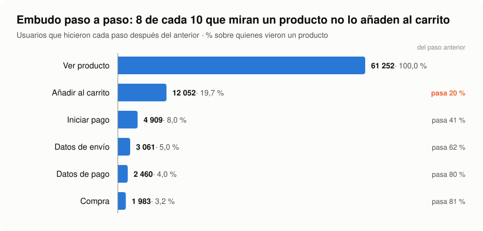

# ¿Qué canales traen clientes que sí compran? · Análisis de GA4 en BigQuery

> 📄 **[Leer el informe completo →](informe.md)** · Avance 2 de 3 publicado (embudo secuencial, dispositivos y retención). Semana 3 (dashboard) en curso.

## La pregunta de negocio
Una tienda en línea invierte tiempo y dinero en varios canales (búsqueda orgánica, anuncios, referencias, correo…). La pregunta es simple:

**¿Qué canales traen visitas que terminan en compra, y en qué paso del camino se pierde la gente?**

## Los datos
- **Fuente:** dataset público de ejemplo de Google Analytics 4 de la *Google Merchandise Store*, publicado por Google en BigQuery:
  `bigquery-public-data.ga4_obfuscated_sample_ecommerce`
- **Periodo:** 1 de noviembre de 2020 al 31 de enero de 2021 (incluye Black Friday y Navidad).
- **Formato:** una tabla por día (`events_YYYYMMDD`), con un registro por evento (vista de página, carrito, compra…).
- **Privacidad:** Google ofusca los datos; algunos valores aparecen como `<Other>` o `(data deleted)`. No hay datos personales.

### Limitaciones que hay que tener en cuenta
- `traffic_source` indica el **canal por el que llegó el usuario la primera vez**, no el de cada visita. Por eso aquí se habla de *canal de adquisición del usuario*.
- El dataset **no incluye el gasto en publicidad**. Si más adelante se estima un costo por canal, se indicará claramente como **dato simulado**.

## Cómo reproducirlo
1. Entra a [BigQuery](https://console.cloud.google.com/bigquery) con una cuenta de Google. El modo *sandbox* es gratuito y no pide tarjeta.
2. Copia cada archivo de la carpeta [`sql/`](sql) en el editor y ejecútalo.
3. Antes de ejecutar, BigQuery muestra cuántos datos va a leer; todas estas consultas están muy por debajo del límite gratuito (1 TB al mes).

## Estructura
```
sql/
  01_panorama_eventos.sql   ← qué eventos existen y cuántos usuarios los generan
  02_canales.sql            ← usuarios, sesiones, compras e ingresos por canal
  03_dispositivos.sql       ← lo mismo, por tipo de dispositivo
  04_embudo_secuencial.sql  ← embudo paso a paso por usuario (ver → carrito → pago → compra)
  05_cohortes_retencion.sql ← de los usuarios nuevos de cada semana, cuántos vuelven en 30 días
resultados/                 ← resultados de cada consulta en CSV
informe.md                  ← el estudio: hallazgos, gráficos y limitaciones
graficos/                   ← gráficos del informe (SVG)
scripts/graficos.mjs        ← genera los gráficos desde los CSV (node scripts/graficos.mjs)
notas/
  semana-1.md               ← guía de trabajo y preguntas de la semana
  semana-2.md               ← guía de la semana 2 (dispositivos, embudo, retención)
dashboard/                  ← (semana 3) dashboard y capturas
```

## Plan
| Semana | Entregable |
|---|---|
| 1 ✅ | Exploración: eventos y canales → [informe, avance 1](informe.md) |
| 2 ✅ | Dispositivos, embudo secuencial y cohortes de retención → [informe, avance 2](informe.md#5-hallazgo-3--el-celular-ya-no-es-un-canal-secundario-avance-2) |
| 3 | Dashboard (resumen, embudo, canales), informe de una página y conclusiones |

## Hallazgos principales


- **Solo el 1,6 % de los visitantes compra**, y la mayor fuga está **antes del carrito**: el 80 % de quienes ven un producto no lo añade.
- **6 de cada 10 personas con productos en el carrito nunca empiezan a pagar**; una vez en el pago, 8 de cada 10 terminan cada paso. *(El avance 2 corrige la cifra del 41 % del avance 1.)*
- **El celular trae el 40 % de las visitas y convierte igual o mejor que la computadora** (1,64 % frente a 1,54 %).
- **Solo el 10,7 % de los usuarios nuevos vuelve en 30 días**; los de diciembre, compradores de regalos, apenas el 8 %.
- **Google orgánico** trae el 31 % de las visitas, pero convierte por debajo del promedio, y **los anuncios de Google** tienen la conversión (1,06 %) y el ticket (USD 54,6) más bajos.
- **El 8 % de las sesiones son autorreferencias**: un error de medición que le quita el crédito a los canales reales.

👉 Detalle, gráficos, tablas y limitaciones en el **[informe](informe.md)**.

## Herramientas
SQL (BigQuery) · Google Analytics 4 · Power BI / Looker Studio

---
Autor: **Jose Manuel Güere Casas** · [Portafolio](https://jguere2811.github.io)
