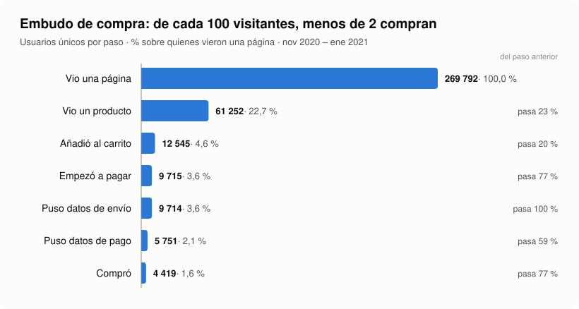
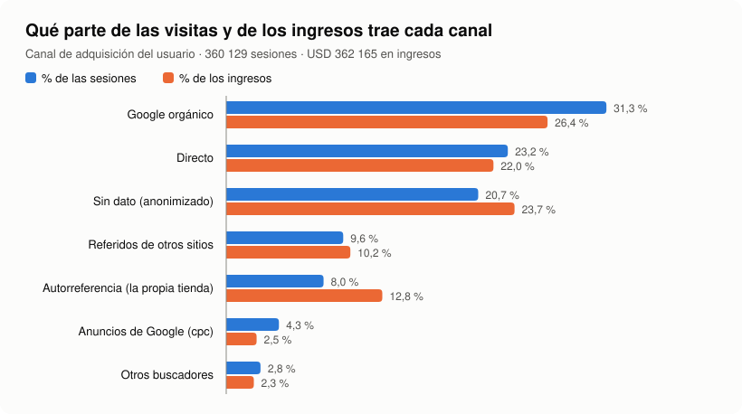
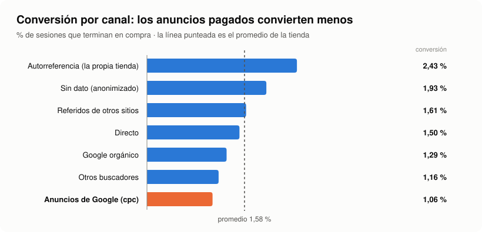

# Informe · ¿Dónde pierde clientes una tienda en línea?
**Estudio del comportamiento de compra de la Google Merchandise Store (GA4, nov. 2020 – ene. 2021)**

*Autor: Jose Manuel Güere Casas · Estado: **avance 1 de 3** (exploración) · Última actualización: noviembre de 2026*

---

## Resumen ejecutivo
| | Hallazgo | Qué haría la tienda |
|---|---|---|
| 1 | **Solo el 1,6 % de los visitantes compra.** La mayor fuga ocurre **antes del carrito**: el 77 % no abre ningún producto y, de los que lo abren, el 80 % no lo añade al carrito. | Mejorar portada, búsqueda y fichas de producto antes que el proceso de pago. |
| 2 | En el pago, **el 41 % abandona entre los datos de envío y los de pago.** | Revisar el costo de envío y los medios de pago en ese paso. |
| 3 | **Google orgánico** trae la mayor parte de las visitas (31 %), pero **convierte por debajo del promedio** (1,29 % frente a 1,58 %). | Llevar ese tráfico a páginas de producto y no solo a la portada. |
| 4 | **Los anuncios de Google (cpc) tienen la conversión más baja (1,06 %) y el ticket más bajo (USD 54,6).** | Revisar segmentación y anuncios; con el gasto real, calcular el retorno. |
| 5 | **El 8 % de las sesiones son autorreferencias** (la tienda figura como origen de sí misma) y **cerca del 21 % no tiene canal** por la anonimización. | Corregir la configuración de dominios en GA4 para no perder el canal real. |

---

## 1. Contexto y pregunta
Una tienda en línea invierte en varios canales para atraer visitas. Este estudio responde dos preguntas:
1. **¿En qué paso del camino de compra se pierde la gente?**
2. **¿Qué canales traen visitas que terminan en compra?**

## 2. Datos y método
- **Fuente:** dataset público de Google Analytics 4 de la *Google Merchandise Store* en BigQuery (`bigquery-public-data.ga4_obfuscated_sample_ecommerce`).
- **Periodo:** 1 de noviembre de 2020 al 31 de enero de 2021 (92 días, incluye Black Friday y Navidad).
- **Volumen:** unos 4,3 millones de eventos, 360 129 sesiones y 5 692 compras.
- **Herramientas:** SQL en BigQuery para extraer y agregar los datos; los gráficos se generan desde los CSV con un script ([`scripts/graficos.mjs`](scripts/graficos.mjs)).
- **Consultas:** [`sql/01_panorama_eventos.sql`](sql/01_panorama_eventos.sql) y [`sql/02_canales.sql`](sql/02_canales.sql). Los resultados están en [`resultados/`](resultados).

---

## 3. Hallazgo 1 · El embudo: la gente se va antes de llegar al carrito

| Paso | Usuarios | % del total | % que pasa del paso anterior |
|---|---:|---:|---:|
| Vio una página | 269 792 | 100,0 % | — |
| Vio un producto | 61 252 | 22,7 % | 22,7 % |
| Añadió al carrito | 12 545 | 4,6 % | 20,5 % |
| Empezó a pagar | 9 715 | 3,6 % | 77,4 % |
| Puso datos de envío | 9 714 | 3,6 % | ~100 % |
| Puso datos de pago | 5 751 | 2,1 % | 59,2 % |
| **Compró** | **4 419** | **1,6 %** | 76,8 % |

**Lectura:**
- De cada **100 visitantes, menos de 2 compran**.
- **Las dos caídas más grandes están al inicio.** Casi 8 de cada 10 personas no abren ningún producto y, de quienes lo abren, 8 de cada 10 no lo añaden al carrito. El problema principal es **despertar el interés**, no cobrar.
- **Una vez en el pago, la mayoría sigue,** salvo en un punto: entre los datos de envío y los de pago se pierde el **41 %**. Es típico de un costo de envío que aparece tarde o de pocos medios de pago.
- **El 95 % de los usuarios del periodo son nuevos** (`first_visit`: 257 314 de 269 792). La tienda casi no consigue que la gente vuelva; esto se estudia en el avance 2.

---

## 4. Hallazgo 2 · Los canales: muchas visitas no significa muchas ventas

| Canal | Sesiones | % sesiones | % ingresos | Conversión | Ticket promedio |
|---|---:|---:|---:|---:|---:|
| Google orgánico | 112 678 | 31,3 % | 26,4 % | 1,29 % | USD 65,9 |
| Directo | 83 459 | 23,2 % | 22,0 % | 1,50 % | USD 63,7 |
| Sin dato (anonimizado) | 74 687 | 20,7 % | 23,7 % | 1,93 % | USD 59,5 |
| Referidos de otros sitios | 34 675 | 9,6 % | 10,2 % | 1,61 % | USD 66,4 |
| Autorreferencia (la propia tienda) | 28 849 | 8,0 % | 12,8 % | 2,43 % | USD 66,4 |
| Anuncios de Google (cpc) | 15 618 | 4,3 % | 2,5 % | **1,06 %** | **USD 54,6** |
| Otros buscadores | 10 163 | 2,8 % | 2,3 % | 1,16 % | USD 69,8 |
| **Total / promedio** | **360 129** | 100 % | 100 % | **1,58 %** | **USD 63,6** |

*Conversión = compras ÷ sesiones. Ticket = ingresos ÷ compras.*

**Lectura:**
- **Google orgánico** es el canal más grande, pero aporta menos ingresos que visitas (31 % de las sesiones y 26 % de los ingresos). Atrae a mucha gente que solo está mirando.
- **Los anuncios pagados son el canal más débil:** la conversión más baja y el ticket más bajo. Sin el gasto en publicidad no se puede saber si dan pérdida, pero sí que **rinden menos que el tráfico gratuito**.
- **La autorreferencia no es un canal real.** Que la propia tienda aparezca como "sitio que refiere" suele indicar que el cliente salió a otro dominio (por ejemplo, la pasarela de pago) y volvió. Como su conversión es la más alta (2,43 %), lo más probable es que **le esté quitando el crédito a los canales que de verdad trajeron esas ventas**.

---

## 5. Limitaciones
1. **Canal de adquisición, no de cada visita.** `traffic_source` guarda el canal por el que el usuario llegó la **primera vez**.
2. **Datos anonimizados.** Cerca del 21 % de las sesiones figura como `<Other>` o `(data deleted)`. Las conclusiones por canal valen para el 79 % restante.
3. **Embudo aproximado.** Cuenta usuarios por evento, sin comprobar que cada persona pasó por los pasos en orden. El embudo secuencial exacto se calcula en el avance 2.
4. **Compras = eventos `purchase`** (5 692), no clientes únicos (4 419).
5. **Sin gasto publicitario.** No se calcula el costo por venta ni el retorno de los anuncios.

## 6. Próximos pasos
- **Avance 2:** embudo secuencial por usuario, rendimiento por dispositivo y cohortes de retención (¿cuántos vuelven en 30 días?).
- **Avance 3:** dashboard interactivo y recomendaciones finales priorizadas.
