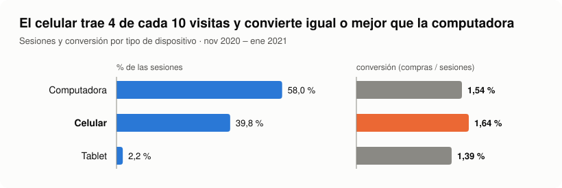
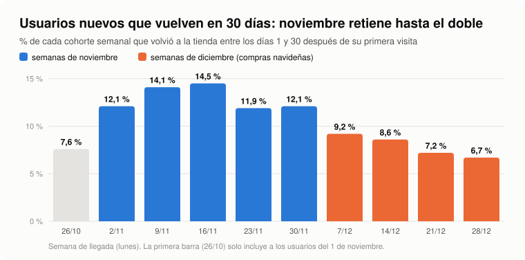

# Informe · ¿Dónde pierde clientes una tienda en línea?
**Estudio del comportamiento de compra de la Google Merchandise Store (GA4, nov. 2020 – ene. 2021)**

*Autor: Jose Manuel Güere Casas · Estado: **versión final** (avances 1–3: canales, embudo, dispositivos, retención y dashboard) · Última actualización: noviembre de 2026*

---

## Resumen ejecutivo
| | Hallazgo | Qué haría la tienda |
|---|---|---|
| 1 | **Solo el 1,6 % de los visitantes compra.** La mayor fuga ocurre **antes del carrito**: el 77 % no abre ningún producto y, siguiendo a cada persona paso a paso, **el 80 % de quienes ven un producto no lo añade al carrito**. | Mejorar portada, búsqueda y fichas de producto antes que el proceso de pago. |
| 2 | **Dentro del pago, la fuga está al inicio:** de quienes tienen algo en el carrito, **solo el 41 % empieza a pagar**, y de esos, el 62 % llega a poner sus datos de envío. Desde ahí, 8 de cada 10 completan cada paso. *(Corrige el avance 1, ver sección 6.)* | Recordatorios de carrito abandonado y mostrar el costo de envío desde el carrito. |
| 3 | **Google orgánico** trae la mayor parte de las visitas (31 %), pero **convierte por debajo del promedio** (1,29 % frente a 1,58 %). | Llevar ese tráfico a páginas de producto y no solo a la portada. |
| 4 | **Los anuncios de Google (cpc) tienen la conversión más baja (1,06 %) y el ticket más bajo (USD 54,6).** | Revisar segmentación y anuncios; con el gasto real, calcular el retorno. |
| 5 | **El 8 % de las sesiones son autorreferencias** (la tienda figura como origen de sí misma) y **cerca del 21 % no tiene canal** por la anonimización. | Corregir la configuración de dominios en GA4 para no perder el canal real. |
| 6 | **El celular trae el 40 % de las visitas y convierte igual o mejor que la computadora** (1,64 % frente a 1,54 %). | Tratar el celular como canal principal: probar primero en móvil cada cambio de diseño y del pago. |
| 7 | **Solo 1 de cada 10 usuarios nuevos vuelve en 30 días** (10,7 %). Los que llegan en noviembre vuelven bastante más (12,9 %) que los de diciembre (8,3 %), que compran para Navidad y no regresan. | Campañas de correo y descuentos de segunda compra para los clientes de fin de año. |

---

## 1. Contexto y pregunta
Una tienda en línea invierte en varios canales para atraer visitas. Este estudio responde dos preguntas:
1. **¿En qué paso del camino de compra se pierde la gente?**
2. **¿Qué canales traen visitas que terminan en compra?**

## 2. Datos y método
- **Fuente:** dataset público de Google Analytics 4 de la *Google Merchandise Store* en BigQuery (`bigquery-public-data.ga4_obfuscated_sample_ecommerce`).
- **Periodo:** 1 de noviembre de 2020 al 31 de enero de 2021 (92 días, incluye Black Friday y Navidad).
- **Volumen:** unos 4,3 millones de eventos, 360 129 sesiones y 5 692 compras.
- **Herramientas:** SQL en BigQuery para extraer y agregar los datos; los gráficos se generan desde los CSV con un script ([`scripts/graficos.mjs`](scripts/graficos.mjs)).
- **Consultas:** [`01_panorama_eventos`](sql/01_panorama_eventos.sql), [`02_canales`](sql/02_canales.sql), [`03_dispositivos`](sql/03_dispositivos.sql), [`04_embudo_secuencial`](sql/04_embudo_secuencial.sql) y [`05_cohortes_retencion`](sql/05_cohortes_retencion.sql). Los resultados están en [`resultados/`](resultados).

---

## 3. Hallazgo 1 · El embudo: la gente se va antes de llegar al carrito

| Paso | Usuarios | % del total | % que pasa del paso anterior |
|---|---:|---:|---:|
| Vio una página | 269 792 | 100,0 % | — |
| Vio un producto | 61 252 | 22,7 % | 22,7 % |
| Añadió al carrito | 12 545 | 4,6 % | 20,5 % |
| Empezó a pagar | 9 715 | 3,6 % | 77,4 % |
| Puso datos de envío | 9 714 | 3,6 % | ~100 % |
| Puso datos de pago | 5 751 | 2,1 % | 59,2 % |
| **Compró** | **4 419** | **1,6 %** | 76,8 % |

**Lectura:**
- De cada **100 visitantes, menos de 2 compran**.
- **Las dos caídas más grandes están al inicio.** Casi 8 de cada 10 personas no abren ningún producto y, de quienes lo abren, 8 de cada 10 no lo añaden al carrito. El problema principal es **despertar el interés**, no cobrar.
- ~~Una vez en el pago, la mayoría sigue, salvo entre los datos de envío y los de pago, donde se pierde el 41 %.~~ **Corregido en el avance 2:** siguiendo a cada persona en orden, esa pérdida es del 20 % y la fuga real del pago está entre el carrito y el inicio del pago (ver sección 6).
- **El 95 % de los usuarios del periodo son nuevos** (`first_visit`: 257 314 de 269 792). La tienda casi no consigue que la gente vuelva; esto se mide en la sección 7.

---

## 4. Hallazgo 2 · Los canales: muchas visitas no significa muchas ventas

| Canal | Sesiones | % sesiones | % ingresos | Conversión | Ticket promedio |
|---|---:|---:|---:|---:|---:|
| Google orgánico | 112 678 | 31,3 % | 26,4 % | 1,29 % | USD 65,9 |
| Directo | 83 459 | 23,2 % | 22,0 % | 1,50 % | USD 63,7 |
| Sin dato (anonimizado) | 74 687 | 20,7 % | 23,7 % | 1,93 % | USD 59,5 |
| Referidos de otros sitios | 34 675 | 9,6 % | 10,2 % | 1,61 % | USD 66,4 |
| Autorreferencia (la propia tienda) | 28 849 | 8,0 % | 12,8 % | 2,43 % | USD 66,4 |
| Anuncios de Google (cpc) | 15 618 | 4,3 % | 2,5 % | **1,06 %** | **USD 54,6** |
| Otros buscadores | 10 163 | 2,8 % | 2,3 % | 1,16 % | USD 69,8 |
| **Total / promedio** | **360 129** | 100 % | 100 % | **1,58 %** | **USD 63,6** |

*Conversión = compras ÷ sesiones. Ticket = ingresos ÷ compras.*

**Lectura:**
- **Google orgánico** es el canal más grande, pero aporta menos ingresos que visitas (31 % de las sesiones y 26 % de los ingresos). Atrae a mucha gente que solo está mirando.
- **Los anuncios pagados son el canal más débil:** la conversión más baja y el ticket más bajo. Sin el gasto en publicidad no se puede saber si dan pérdida, pero sí que **rinden menos que el tráfico gratuito**.
- **La autorreferencia no es un canal real.** Que la propia tienda aparezca como "sitio que refiere" suele indicar que el cliente salió a otro dominio (por ejemplo, la pasarela de pago) y volvió. Como su conversión es la más alta (2,43 %), lo más probable es que **le esté quitando el crédito a los canales que de verdad trajeron esas ventas**.

---

## 5. Hallazgo 3 · El celular ya no es un canal secundario *(avance 2)*

| Dispositivo | Sesiones | % sesiones | Añadidos al carrito | Compras | Conversión | Ingreso por sesión |
|---|---:|---:|---:|---:|---:|---:|
| Computadora | 208 942 | 58,0 % | 34 047 | 3 226 | 1,54 % | USD 1,00 |
| **Celular** | 143 185 | 39,8 % | 23 223 | 2 355 | **1,64 %** | **USD 1,03** |
| Tablet | 8 002 | 2,2 % | 1 273 | 111 | 1,39 % | USD 0,82 |

**Lectura:**
- **4 de cada 10 visitas llegan desde el celular**, y ahí se compra **igual o un poco mejor** que en la computadora: más conversión (1,64 % frente a 1,54 %) y algo más de ingreso por visita.
- La diferencia es pequeña, así que la conclusión no es "el celular es mejor", sino que **la experiencia móvil ya funciona y no frena las ventas**. Cualquier cambio en las fichas de producto o en el pago debería probarse primero en el celular, porque ahí está casi la mitad del público.
- **La tablet pesa poco** (2 % de las sesiones) y convierte menos; no justifica un esfuerzo aparte.

---

## 6. Hallazgo 4 · El embudo paso a paso *(avance 2)*

Aquí cada persona solo cuenta en un paso si lo hizo **después** del paso anterior. Es más estricto que el embudo del avance 1, que contaba quién hizo cada evento sin mirar el orden.

| Paso | Usuarios | % desde "ver producto" | % que pasa del paso anterior |
|---|---:|---:|---:|
| Ver producto | 61 252 | 100,0 % | — |
| Añadir al carrito | 12 052 | 19,7 % | **19,7 %** |
| Iniciar pago | 4 909 | 8,0 % | **40,7 %** |
| Datos de envío | 3 061 | 5,0 % | 62,4 % |
| Datos de pago | 2 460 | 4,0 % | 80,4 % |
| Compra | 1 983 | 3,2 % | 80,6 % |

**Lectura:**
- **La fuga más grande se confirma:** de quienes ven un producto, **solo el 20 % lo añade al carrito**.
- **La segunda fuga es entre el carrito y el pago:** 6 de cada 10 personas con productos en el carrito **nunca empiezan a pagar**. Es el clásico carrito abandonado.
- **Una vez que alguien pone sus datos de envío, 8 de cada 10 terminan cada paso.** El tramo final del pago funciona bien.

**Corrección al avance 1.** El avance 1 decía que el 41 % abandona entre los datos de envío y los de pago. Al seguir el orden real, esa pérdida es del **20 %**. La diferencia se explica porque el evento de "datos de envío" se registraba casi siempre junto con "iniciar pago" (9 714 frente a 9 715 usuarios), así que el embudo sin orden inflaba ese paso. **El problema del pago está al inicio (carrito → iniciar pago), no al final.** Por eso la recomendación cambia: recordatorios de carrito abandonado y mostrar el costo de envío desde el carrito.

*Nota:* el embudo secuencial termina con 1 983 compradores, menos que los 4 419 del total. Muchos compradores no registraron "ver producto" antes de comprar (por ejemplo, compraron desde el carrito de una visita anterior o la anonimización borró eventos), así que no entran en este embudo estricto.

---

## 7. Hallazgo 5 · Casi nadie vuelve: retención por cohortes *(avance 2)*

Una **cohorte** es el grupo de usuarios que visitó la tienda por primera vez en la misma semana. Se mide qué porcentaje volvió en los 30 días siguientes.

| Semana de llegada | Usuarios nuevos | Vuelven días 1–7 | Días 8–14 | Días 15–30 | **En 30 días** |
|---|---:|---:|---:|---:|---:|
| 26 oct\* | 1 948 | 6,3 % | 1,7 % | 1,4 % | 7,6 % |
| 2 nov | 16 496 | 9,3 % | 2,0 % | 2,9 % | 12,1 % |
| 9 nov | 14 598 | 10,5 % | 3,0 % | 3,5 % | 14,1 % |
| 16 nov | 16 901 | 10,7 % | 3,1 % | 3,6 % | **14,5 %** |
| 23 nov (Black Friday) | 18 738 | 9,3 % | 2,4 % | 2,5 % | 11,9 % |
| 30 nov (Cyber Monday) | 21 192 | 9,9 % | 2,6 % | 1,7 % | 12,1 % |
| 7 dic | 27 560 | 7,5 % | 1,3 % | 1,5 % | 9,2 % |
| 14 dic | 24 216 | 6,8 % | 1,2 % | 1,9 % | 8,6 % |
| 21 dic | 17 015 | 5,4 % | 1,3 % | 1,5 % | 7,2 % |
| 28 dic | 9 834 | 5,1 % | 1,2 % | 1,3 % | **6,7 %** |

\* *La semana del 26 de octubre solo incluye a los usuarios del 1 de noviembre (el dataset empieza ese día), por eso se excluye de los promedios.*

**Lectura:**
- **En promedio, solo el 10,7 % de los usuarios nuevos vuelve en 30 días**, y la mayoría de los que vuelven lo hace en la **primera semana** (8,3 %). Después, el regreso es casi nulo.
- **Los que llegan a mediados de noviembre son los más fieles** (14,1 % y 14,5 %): probablemente gente que compara antes de Black Friday y vuelve a comprar.
- **Diciembre trae más visitantes nuevos, pero menos fieles:** la semana del 7 de diciembre es la de más usuarios nuevos (27 560), pero solo el 9,2 % vuelve, y a fin de año baja a 6,7 %. Son **compradores de regalos de una sola vez**.
- **Oportunidad:** los clientes de diciembre son muchos y casi no regresan. Un correo de agradecimiento con un descuento para la segunda compra en enero podría recuperar parte de ese volumen.

---

## 8. Limitaciones
1. **Canal de adquisición, no de cada visita.** `traffic_source` guarda el canal por el que el usuario llegó la **primera vez**.
2. **Datos anonimizados.** Cerca del 21 % de las sesiones figura como `<Other>` o `(data deleted)`. Las conclusiones por canal valen para el 79 % restante.
3. **Embudo del avance 1 aproximado.** Contaba usuarios por evento sin mirar el orden; el embudo secuencial (sección 6) es el que vale para decidir.
4. **Embudo secuencial sin límite de visita.** No exige que todos los pasos ocurran en la misma visita; alguien puede ver un producto hoy y comprarlo días después. Para una tienda donde se compara antes de comprar, es razonable.
5. **Compras = eventos `purchase`** (5 692), no clientes únicos (4 419).
6. **Retención medida por actividad, no por compra.** "Volver" significa tener cualquier actividad en la tienda, no necesariamente comprar de nuevo.
7. **Sin gasto publicitario.** No se calcula el costo por venta ni el retorno de los anuncios.

## 9. Entregables finales *(avance 3)*
- **[Dashboard interactivo](https://jguere2811.github.io/proyectos/dashboard-ga4.html):** indicadores, embudo, canales (con selector de métrica), dispositivos y mapa de calor de retención. Funciona en celular y en modo oscuro.
- **[Informe ejecutivo de una página (PDF)](informe-ejecutivo.pdf):** hallazgos y recomendaciones priorizadas para presentar a un gerente.

## 10. Qué haría después
- Sumar el **gasto publicitario por canal** para medir el costo por venta y el retorno de Google Ads.
- Hacer una **prueba A/B en la página de producto** (fotos y costo de envío visibles) y medir el cambio en "añadir al carrito".
- Automatizar la actualización del dashboard con una **consulta programada** en BigQuery.
